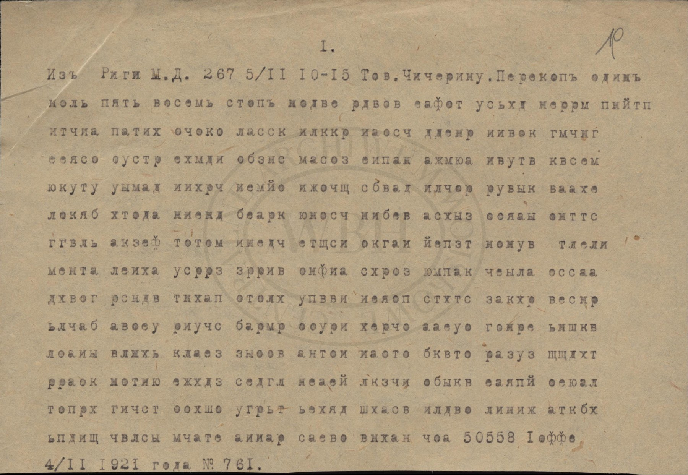

# Telegram no. 761: a Soviet cipher telegram from the Riga peace talks, 1921

Devin O'Keefe, October 2026. Not peer-reviewed.



*Centralne Archiwum Wojskowe (WBH), Warsaw, Oddział II NDWP, I.301.8.663, part 1, leaf 19.*

In the winter of 1920-21 a Soviet delegation led by Adolf Joffe was in Riga, negotiating the treaty that ended
the Polish-Soviet war. It reported to Moscow by radio, in cipher, and Polish radio intelligence listened in and
typed up what it heard. The Central Military Archives in Warsaw have a file of such copies from the first months
of 1921, still in cipher, and put scans of it online in 2020. None of the telegrams in it seems to have been
published deciphered.

The sheet above is one of them: telegram no. 761, from Joffe to the foreign commissar Chicherin, dated
4 February 1921. This repository gives its text and its key, with a program that finds the key from the cipher
text. The telegram turns out to be a personnel matter. The doctor who looked after the delegation's staff wanted
to move to Russia, and Joffe was asking the health commissariat whether it would take him on.

## What it says

> Для Наркомздрава, Семашко. Врач, пользующий сотрудников мирной делегации, Георгий Владимирович Фрид выразил
> желание переехать в Россию на постоянную работу. Он имеет за собой двадцать три года практики, был в свое время
> врачебным инспектором Камчатской области, а во время войны начальником Трапезундского эвакпункта. А разрешение
> на выезд в Россию Фрид может получить, ибо за него ручаются товарищи как за политически честного человека,
> сочувствующего Соввласти. Сообщите, согласны ли его принять на службу в Наркомздрав, ибо Фриду в случае выезда
> необходимо выдать подъемные за счет Наркомздрава, на что нужно Ваше согласие.

In English:

> For the People's Commissariat of Health, Semashko. The doctor who attends the staff of the peace delegation,
> Georgy Vladimirovich Frid, has expressed a wish to move to Russia for permanent work. He has twenty-three years
> of practice behind him, was at one time medical inspector of the Kamchatka region and, during the war, head of
> the Trebizond evacuation point. Frid can get permission to leave for Russia, since comrades vouch for him as a
> politically honest man who sympathises with Soviet power. Let us know whether you agree to take him into the
> service of the Commissariat of Health, since if he leaves Frid must be paid a removal allowance at the
> Commissariat's expense, and for that your consent is needed.

That is the whole telegram, 558 letters. The cipher clerk spelled out three full stops and a comma as тчк and
зпт; the capitals and the rest of the punctuation have been added. In the Polish copy 23 letters do not fit
their words, such as оеиашко for Семашко and двадуать for двадцать, and they have been corrected from the
sense. Two of them may be the clerk's spelling rather than mistakes. They are all listed in
[docs/TEXT.md](docs/TEXT.md).

## The doctor

Because the telegram gives the doctor's full name and the outline of his career, the reading can be checked
against other records. The *Russian Medical List*, the register of doctors published by the imperial Ministry of
the Interior, has a Georgy Vladimirovich Frid who was born in 1871 and qualified in 1897. He became acting
medical inspector of the Kamchatka region in April 1912 and was still at Petropavlovsk in May 1916. Counting from
1897, he had twenty-three years of practice by the winter of 1920-21, as the telegram says.

The 1908 volume of the same register has him in Riga, as a staff doctor at the asylum at Alexandershöhe, so he
knew the town from before the war. Nothing has been found on his time at Trebizond, or on what Moscow replied.
There is more in [docs/PEOPLE.md](docs/PEOPLE.md).

## How the cipher works

It is a columnar transposition, which means the letters of the message are unchanged and only their order is
scrambled. The cipher clerk wrote the text in rows of 26 letters under a row of key numbers, then copied it
out one column at a time, starting with the column numbered 1 and going on to 2, 3 and so on. These are the first
five of the 22 rows:

```
 9  8 23  1 13 17 11 24  6 21  7  4 10 15 26 14 18 22 25 12 19  3 20  5 16  2

 д  л  я  н  а  р  к  о  м  з  д  р  а  в  а  х  о  е  и  а  ш  к  о  х  в  р
 а  ч  п  о  л  ь  з  у  ю  щ  и  и  с  о  т  р  у  д  н  и  к  о  в  м  и  р
 н  о  й  д  е  л  е  г  а  щ  и  и  х  г  е  о  р  г  и  й  в  л  а  д  и  м
 и  р  о  в  и  ч  ф  р  и  д  х  в  ы  р  а  з  и  л  ж  е  л  а  н  и  е  п
 е  р  е  е  х  а  т  ь  в  х  р  о  з  с  и  ю  х  н  а  п  о  с  т  о  я  н
```

The column under the 1 reads н о д в е, and those are the first five letters on the sheet in the picture:
`нодве рдвов еафот ...`. Read across, the rows give для наркомздрава х оеиашко х врач пользующии сотрудников
мирной делегащии х георгий владимирович фрид х выразил желание ... There are no spaces, the clerk has put an х
before and after each proper name after the first word, and the copyist's mistakes are still in.

## How it was read

The commonest letters in the telegram are о, а, и and е, in about the proportions of any Russian text, so the
letters had been moved around but had not been replaced by others. That fits what John Tiltman remembered of the
Soviet diplomatic telegrams he worked on for the British from August 1920, which were at first in plain
columnar transposition; from about November a substitution into figures was put in front of it.

The number of columns and the order in which they were copied out still had to be found. The program in
[code/](code/README.md) tries every width from 2 to 35. At each width it keeps rearranging the columns and holds
on to the changes that make the rows look more like Russian. It judges this by how likely each letter is to
follow the one before it, and the arrangement it ends with is scored on three-letter sequences; both come from
a table of three-letter frequencies counted in Soviet diplomatic documents of the same months.

At 26 columns all ten runs of the search come back with the same key, and the text reads from the first word. At
the other 33 widths nothing readable comes out. On the program's scale, where ordinary Russian prose scores about
-2.1 and the telegram's letters in random order about -5.1, the text at 26 columns scores -2.96 and the best that
any other width can manage is -4.04.

To test the program itself, it was given six other Russian texts of the same length, each with 23 letters
spoiled, enciphered with random keys of 16 to 41 columns. It found every key of up to 31 columns and began to
miss them beyond that, which is why the search stops at 35. From the telegram's own letters in shuffled order it
produced nothing readable. The details are in [docs/METHOD.md](docs/METHOD.md).

## Caveats

- Only this telegram is read. It is the one telegram in the file that is written in letters. The rest are in
  groups of five figures, traffic between Moscow and Riga, Stockholm and Berlin, and they are untouched here.
- The text comes from a Polish copy of an intercepted radiogram. The Soviet original has not been seen. The copy
  has 23 letters that have been corrected and six more that are hard to make out on the scan, but no word
  depends on any of them.
- Two groups of figures go with the telegram, 1058 before the text and 50558 after it. The 558 is the letter
  count and the rest is unexplained. If the key was made from a phrase, as was usual, the phrase is unknown.
- Frid's entries in the Medical List were read from the Russian State Library's OCR text and from an online
  transcription, because the library's viewer would not load the page images in full. The 1908 entry is known
  only from a Google Books snippet.
- No earlier reading of this telegram has been found in print or online. The Poles may still have read it at the
  time. Their codebreakers were reading the delegation's telegrams in the autumn of 1920, and a transposition
  like this one was well within their reach. [docs/LITERATURE.md](docs/LITERATURE.md) lists what was searched
  and what could not be consulted.

## Running the code

```
python code/reproduce.py
```

You need Python 3.9 or later and nothing else. A full run takes four to seven minutes on a fast desktop. It
deciphers the telegram with the key, finds the key again from the cipher text alone, runs the controls, and then
prints the 21 figures of these pages that the scripts compute, each beside the value quoted.
`python code/reproduce.py --check` prints the same comparison from the saved results without recomputing
anything. Figures taken from the sources, such as dates and the register entries, and the size of the text
that the letter table was counted from are not part of the comparison.

The picture at the top is page 21 of the archive's PDF of the file, with the scanner's border trimmed off:
<https://web.archive.org/web/20200703151708/https://wbh.wp.mil.pl/c/pages/atts/2020/6/I_301_8_663_1.pdf>
(139 MB). [data/telegram761.txt](data/telegram761.txt) follows the sheet line by line.

## What's in the repository

| path | what |
|---|---|
| [docs/TEXT.md](docs/TEXT.md) | the sheet, the cipher text, the deciphered rows, the reading and the 23 corrections |
| [docs/METHOD.md](docs/METHOD.md) | how the cipher was recognised and the key found, and how the search was tested |
| [docs/PEOPLE.md](docs/PEOPLE.md) | Frid in the medical register, and the other people and places named |
| [docs/LITERATURE.md](docs/LITERATURE.md) | the archive file, earlier work, and where an earlier reading was looked for |
| [data/](data/README.md) | transcription, key, reading, trigram table, control texts |
| [code/](code/README.md) | the scripts |
| results/ | their output |
| images/ | the scan of the telegram |

## Sources

- Warsaw, Centralne Archiwum Wojskowe (Wojskowe Biuro Historyczne), Oddział II NDWP, I.301.8.663, part 1,
  leaf 19. This is the Polish Cipher Bureau's copy of the telegram.
- Marek Grajek, "Documents of Polish-Soviet War of 1919-1920 Codebreaking", *Proceedings of HistoCrypt 2021*,
  pp. 62-69, <https://doi.org/10.3384/ecp183158>. A survey of the archive's cipher files, this one included.
- John H. Tiltman, "Experiences 1920-1939", for the Soviet diplomatic ciphers of 1920.
- *Документы внешней политики СССР*, vol. 3 (Moscow, 1959). These are the Soviet diplomatic documents of July
  1920 to March 1921, and the program's idea of what Russian looks like was counted from them.
- *Россійскій медицинскій списокъ*, the imperial register of doctors, in the volumes for 1908, 1913, 1914 and
  1916.
- Grzegorz Nowik, *Zanim złamano "Enigmę"*, 2 vols (Warsaw, 2004 and 2010), on Polish radio intelligence in
  1918-20. Only searched through Google Books so far.

Full references are in [docs/LITERATURE.md](docs/LITERATURE.md).

## Licence

The code is under the MIT licence and the text and data are under CC BY 4.0. The scan of the telegram is the
archive's and is not covered by either. See [LICENSE.md](LICENSE.md).
